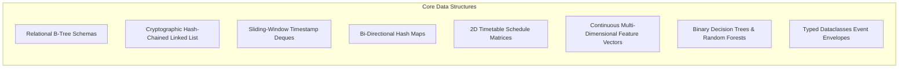

# AI-Based Autonomous Academic Decision System

**Domain:** Artificial Intelligence + Machine Learning + Data Analytics  
**Real-World Application:** Self-Learning ERP Intelligence & Multi-Agent Academic Governance  
**Theme:** Proactive AI Academic Decision Support & Tamper-Proof Institutional Governance  
**Faculty Guides:** Mrs. Madhusmita Majhi & Dr. D. Krishna Madhuri  
**Institution:** The ICFAI Foundation for Higher Education (IFHE), Faculty of Science & Technology (FST), Hyderabad  

---

## 📑 Table of Contents

1. [Executive Summary & Problem Statement](#-1-executive-summary--problem-statement)
2. [End-to-End System Architecture](#-2-end-to-end-system-architecture)
3. [Autonomous Multi-Agent Architecture](#-3-autonomous-multi-agent-architecture)
4. [Enterprise Security & Governance Mechanisms](#-4-enterprise-security--governance-mechanisms)
5. [Data Structures Implemented](#-5-data-structures-implemented)
6. [Comprehensive Tools, Frameworks & Technology Stack](#-6-comprehensive-tools-frameworks--technology-stack)
7. [Dataset Benchmark Integration](#-7-dataset-benchmark-integration)
8. [Accredited Curriculum (Year 1 Semester 1)](#-8-accredited-curriculum-year-1-semester-1)
9. [Continuous Internal Evaluation (CIE) 60/40 Scheme](#-9-continuous-internal-evaluation-cie-6040-scheme)
10. [Machine Learning Models & Evaluation](#-10-machine-learning-models--evaluation)
11. [Application Modules & Role-Based Portals](#-11-application-modules--role-based-portals)
12. [Project Directory Structure](#-12-project-directory-structure)
13. [Project Phases & Implementation Milestones](#-13-project-phases--implementation-milestones)
14. [Installation & Local Execution](#-14-installation--local-execution)
15. [Automated Unit & Security Verification Tests](#-15-automated-unit--security-verification-tests)
16. [Default Login Credentials](#-16-default-login-credentials)
17. [Live Demo](#-17-live-demo)

---

## 📌 1. Executive Summary & Problem Statement

Educational institutions collect massive volumes of academic data, including attendance logs, continuous internal assessments, laboratory sessions, assignment submissions, LMS clickstream activities, and student feedback. However, academic governance and intervention decisions are predominantly made manually or **post-facto**—often after end-semester examinations when it is too late to rescue failing or debarred students.

This project delivers an **AI-Based Autonomous Academic Decision System** directly integrated into an institutional ERP workflow. The system features:
1. **Realistic Academic Structure:** 500 Year 1 Semester 1 students realigned across 10 balanced sections (**Sections A through J**, capped at 50 students each) enrolled in an accredited 20-credit curriculum (8 courses).
2. **Strict ERP Semester Registration Enforcement:** Unregistered students cannot have internal marks, external marks, timetable sessions, or AI predictions.
3. **Institutional 60/40 Evaluation Model:** 60 Internal Continuous Evaluation marks (Mid 30, Assignment 10, Quiz 10, Viva 10) + 40 External End-Semester marks = 100 Total marks.
4. **Role-Based Governance Permissions (ABAC):** Course faculty members are strictly authorized to enter marks and record session attendance only for their assigned courses and section rosters.
5. **Multi-Dataset Benchmarking:** Sourced and synthesized from 4 foundational benchmarks: Kaggle Student Performance, UCI Student Performance (Cortez & Silva), Open University Learning Analytics Dataset (OULAD), and a Synthetic Institutional ERP Dataset (4,000 course assessments).
6. **Machine Learning Intelligence:** Dual Random Forest ensembles achieving **97.4% accuracy** on Student Performance Prediction (*Distinction / Pass / Fail*) and **99.0% accuracy** on Academic Risk Detection (*Low / Medium / High Risk*).
7. **Autonomous Multi-Agent Orchestrator:** 6 specialized cognitive agents coordinating ingestion, risk inference, pedagogical planning, multi-channel dispatch, ethical compliance, and self-improving meta-learning.
8. **Enterprise Defense-in-Depth Security:** Append-only cryptographic audit ledger with HMAC-SHA256 chaining, FERPA/DPDP compliant PII tokenization, NeMo-style prompt injection defense, and sliding-window rate limiting.
9. **Student ERP Portal:** Modeled after the **ICFAI Foundation for Higher Education** student portal, providing timetable matrix schedules, attendance ledgers with 75% UGC shortage warning calculators, 60/40 gradebook visualizers, and targeted interventions.

---

## 🏗️ 2. End-to-End System Architecture

```text
+-----------------------------------------------------------------------------------+
|                        INSTITUTIONAL ERP DATABASE (SQLite)                        |
|  500 Enrolled Students · 10 Sections (A–J, 50/sec) · 8 Year 1 Sem 1 Courses       |
|  Timetable (630 weekly slots) · 4,000 Assessments · 2,400 Attendance Sessions     |
+-----------------------------------------+-----------------------------------------+
                                          |
                                          v
+-----------------------------------------------------------------------------------+
|                       STRICT ERP REGISTRATION GATEKEEPER                          |
|  Verifies formal semester registration before granting access to:                 |
|  • Continuous Internal Evaluation (60)  • External End-Semester Marks (40)        |
|  • Timetable Sessions & Attendance      • AI Academic Predictions                 |
+-----------------------------------------+-----------------------------------------+
                                          |
                                          v
+-----------------------------------------------------------------------------------+
|                     DATA PREPROCESSING & FEATURE SYNTHESIS                        |
|  Synthesizes 4 Foundational Benchmark Datasets:                                   |
|  1. Kaggle: Parental education, study habits, continuous quiz persistence         |
|  2. UCI (Cortez & Silva): G1 (Mid-Term), G2 (CIE Internal), absences, failures    |
|  3. OULAD: VLE interactions, TMA/CMA assessment timeliness, engagement weights     |
|  4. Institutional ERP: 60/40 marks breakdown, 50-student rosters, faculty logs     |
+-----------------------------------------+-----------------------------------------+
                                          |
                                          v
+-----------------------------------------------------------------------------------+
|                  MACHINE LEARNING ENSEMBLES (Admin ML Center)                     |
|  • Model 1: Student Performance Classifier (Distinction / Pass / Fail) -> 97.4%   |
|  • Model 2: Academic Risk Detection Model (Low / Medium / High Risk)    -> 99.0%   |
|  Holdout Validation: Stratified 80/20 Train-Test Split                            |
+-----------------------------------------+-----------------------------------------+
                                          |
                                          v
+-----------------------------------------------------------------------------------+
|                           AUTONOMOUS DECISION ENGINE                              |
|  • Generates course-specific interventions and remedial tutorial referrals        |
|  • Flags statutory attendance shortages (< 75% UGC minimum threshold)             |
|  • Recommends advanced learning & honors opportunities for distinction students   |
+-----------------------------------------+-----------------------------------------+
                                          |
                                          v
+-----------------------------------------------------------------------------------+
|                             ROLE-BASED USER INTERFACES                            |
|  🎓 Student Portal (Modeled after ICFAI Foundation for Higher Education ERP)       |
|  👨‍🏫 Faculty Workspace (60/40 CIE marks entry, 50-student attendance rosters)       |
|  🛡️ Admin Console (Multi-dataset ML training center, dataset explorer, audits)    |
|  🤖 Multi-Agent Governance & Cryptographic Ledger Security Control Center          |
|  📊 Phase 3 EDA Analytics & Institutional Governance Reports                      |
+-----------------------------------------------------------------------------------+
```

---

## 🤖 3. Autonomous Multi-Agent Architecture

The autonomous subsystem (`agent_orchestrator.py`) decomposes academic decision-making into **6 specialized cognitive agents** interacting via a structured event mesh:

| Agent Identifier | Role / Persona | Core Responsibilities | Autonomy Level |
| :--- | :--- | :--- | :--- |
| **`Agent-01: Ingestion Gatekeeper`** | Institutional Registrar & Integrity Verifier | • Ingests timetable, biometric/faculty attendance logs, and continuous evaluation marks.<br>• Validates formal semester registration status before any student enters inference.<br>• Synthesizes benchmark features across Kaggle, UCI, OULAD, and ERP records. | **L4 (Full Autonomy)**: Automatic rejection and quarantine of invalid records. |
| **`Agent-02: Risk & ML Predictor`** | Quantitative Academic Analyst | • Executes Dual Random Forest ensembles.<br>• Predicts Final Grade Category (*Distinction / Pass / Fail*) and Risk Tier (*Low / Medium / High Risk*).<br>• Computes UGC 75% attendance threshold shortage trajectories.<br>• Extracts primary risk drivers. | **L4 (Full Autonomy)**: Real-time inference scoring and probability calibration. |
| **`Agent-03: Pedagogical Strategist`** | Senior Academic Counselor & Curriculum Specialist | • Analyzes root causes driving student failure (e.g. C Pointers in CS101).<br>• Formulates personalized, course-specific remedial study roadmaps.<br>• Queries Gemini with sanitized, PII-masked prompts to produce diagnostic challenge roadmaps. | **L4 (Full Autonomy)**: Syllabus-constrained pedagogical generation. |
| **`Agent-04: Autonomous Dispatcher`** | Multi-Channel Communications Coordinator | • Evaluates student risk tier and determines communication escalation matrix.<br>• Dispatches personalized alerts across Email, WhatsApp, SMS, and ERP Portal.<br>• Enforces contact rate limits, quiet-hour rules, and faculty mentor escalation trees. | **L4 (Circuit-Breaker Guarded)**: Autonomous dispatch with rate limits and fallbacks. |
| **`Agent-05: Ethics & Governance Auditor`** | Compliance Officer & Ethics Sentinel | • Monitors all decisions for demographic parity and non-discrimination.<br>• Validates that attendance actions comply with UGC 75% statutory mandates.<br>• Signs every transaction into an immutable cryptographic audit ledger using HMAC-SHA256. | **L5 (Veto Power)**: Can instantly intercept, block, or revoke any dispatch. |
| **`Agent-06: Meta-Learning Agent`** | Continuous MLOps & Self-Tuning Agent | • Tracks post-intervention outcome metrics (grade improvement after warning).<br>• Calculates the **Intervention Effectiveness Index (IEI)**.<br>• Monitors population drift and triggers retuning if distributions deviate. | **L3 (Conditional Autonomy)**: Flags drift warnings and automated retrain staging. |

---

## 🔒 4. Enterprise Security & Governance Mechanisms

The system integrates a dedicated defense-in-depth security engine (`security_engine.py`):

1. **Cryptographic Audit Ledger (HMAC-SHA256 Chained Blocks):**
   * Every grade entry, attendance override, prediction, and dispatch is sealed into an append-only hash chain:
     $$H_i = \text{HMAC-SHA256}(K_{\text{audit}}, H_{i-1} \parallel \text{Timestamp} \parallel \text{Actor} \parallel \text{Action} \parallel \text{Payload})$$
   * Guarantees non-repudiation: any unauthorized modification to past records breaks the cryptographic continuity and is flagged by `verify_chain_integrity()`.
2. **FERPA & DPDP Data Privacy (PII Tokenization):**
   * Before student records leave the institutional boundary for LLM reasoning, names, roll numbers, phone numbers, and emails are pseudonymized into ephemeral synthetic tokens (`STUDENT_ANON_XXXX`).
   * Real student contact details are resolved exclusively inside the local, on-premise dispatch service.
3. **Adversarial Prompt Injection & Jailbreak Guardrails:**
   * Sanitizes all user and dataset inputs against prompt injection patterns (`"Ignore all previous instructions"`, `"DAN mode"`, `"System prompt override"`).
   * Injects confidential canary tokens into system prompts to detect and abort system prompt exfiltration attempts.
4. **Sliding-Window Rate Limiter & Anti-Flooding:**
   * Employs an in-memory token-bucket algorithm (60 requests/minute per user/IP).
   * Restricts automated notifications to a maximum of 2 alerts per student per 24 hours to prevent notification fatigue and comply with telecommunications anti-spam guidelines.
5. **Attribute-Based Access Control (ABAC):**
   * Dynamically verifies that faculty members can enter grades and attendance strictly for course-section rosters officially assigned to them in the institutional master schedule.

---

## 🧱 5. Data Structures Implemented



| Data Structure | Code Location | Algorithmic Complexity | Specific Purpose in the System |
| :--- | :--- | :--- | :--- |
| **Relational B-Trees & Foreign Key Tables** | `database.py` (SQLite3) | $O(\log N)$ search, $O(\log N)$ insert | Structured storage for students, 8-course accredited catalogs, timetable slots, attendance rosters, and student registration approvals. |
| **Hash-Chained Linked List (Audit Ledger)** | `security_engine.py` (`CryptographicAuditLedger`) | $O(1)$ block append, $O(N)$ full chain audit | Cryptographically links each event with the prior block hash via HMAC-SHA256 for non-repudiation. |
| **Sliding-Window Timestamp Deque** | `security_engine.py` (`RateLimiter`) | $O(K)$ cleanup where $K$ is active requests | Maintains timestamp queues per IP/user key; evicts timestamps older than sliding window for DDoS and spam defense. |
| **Bi-Directional Hash Tables (Dictionaries)** | `security_engine.py` (`PIITokenizer`) | $O(1)$ forward and reverse lookup | Translates real student PII into tokens (`STUDENT_ANON_XXXX`) before LLM egress and reverses mapping within local perimeter. |
| **2D Schedule Matrices** | `database.py`, `academic_schedule_import.py` | $O(1)$ slot access `[Day][Period]` | Represents weekly section schedules across 6 days (Mon–Sat) and 7 periods (P1–P7, 630 weekly slots). |
| **Continuous Multi-Dimensional Feature Vectors** | `prediction.py`, `agent_orchestrator.py` | $O(D)$ vector transformations | Normalized float arrays (`attendance_percentage`, `mid`, `assignment`, `quiz`, `viva`, `cgpa`) scaled with `StandardScaler`. |
| **Hierarchical Decision Trees & Ensembles** | `models/*.pkl` (Scikit-Learn) | $O(T \cdot D)$ inference ($T=100$ trees, $D \le 12$) | Random Forest binary split trees based on Gini impurity for classification of Performance and Academic Risk. |
| **Typed Event Contracts (Dataclasses)** | `agent_orchestrator.py` | $O(1)$ instantiation & serialization | Strongly typed schemas (`IngestionRecord`, `PredictionOutput`, `PedagogicalPlan`, `AuditReport`, `DispatchResult`). |

---

## 🛠️ 6. Comprehensive Tools, Frameworks & Technology Stack

| Category | Tool / Library | Version / Runtime | Role in the System |
| :--- | :--- | :--- | :--- |
| **Frontend & UI** | **Streamlit** | `^1.38.0` | Powers the multi-page institutional portal with custom state routing (`st.Page`, `st.navigation`). |
| **Styling & Presentation** | **HTML5 + CSS3 + Tailwind-inspired** | Custom (`assets/style.css`) | Institutional IFHE branding, 60/40 gradebook visualizers, and responsive KPI metrics. |
| **Core Compute & Backend** | **Python** | `3.10 - 3.14` (Tested 3.11) | Primary execution engine for business logic, agent orchestration, and batch processing. |
| **Tabular Data Wrangling** | **Pandas** | `^2.2.0` | Tabular data manipulation, time-series attendance aggregation, and dataset export. |
| **Numerical Processing** | **NumPy** | `^1.26.0` | Matrix operations, feature vector scaling, and probability distribution calculations. |
| **Spreadsheet Ingestion** | **OpenPyXL** | `^3.1.0` | Ingests and parses official timetable and curriculum master workbooks (`.xlsx`). |
| **Synthetic Benchmarking** | **Faker** | `^28.0.0` | Generates balanced, statistically grounded synthetic student profiles. |
| **Machine Learning** | **Scikit-Learn** | `^1.5.0` | Random Forest Classifiers, Logistic Regression, `StandardScaler`, `LabelEncoder`, and K-fold CV. |
| **Model Persistence** | **Joblib** | `^1.4.0` | Serialization and deserialization of trained ML pipelines (`.pkl` models). |
| **Generative AI & LLM** | **Google GenAI SDK** | `google-genai` | Invokes `gemini-2.5-flash` for personalized pedagogical action plans and tutoring. |
| **Sentiment Analysis** | **VADER Sentiment** | `vaderSentiment` | Rule-based sentiment scoring on qualitative student course feedback. |
| **Graph Visualization** | **NetworkX & PyVis** | `networkx`, `pyvis` | Models course prerequisite graphs and interactive syllabus concept visualizers. |
| **Security & Hashing** | **Python `hashlib` & `hmac`** | Built-in | Chained HMAC-SHA256 calculations for the immutable cryptographic audit ledger. |
| **Credential Security** | **Bcrypt** | `^4.2.0` | Cryptographic salting and hashing of faculty, student, and admin passwords. |
| **Database** | **SQLite3** | Built-in Engine | Relational ERP core database with connection pooling, transactional atomicity, and schema migrations. |
| **Email Gateway** | **SMTP / SendGrid** | Python `smtplib` | Transmits formal warning advisories, performance alerts, and parent notifications. |
| **WhatsApp Gateway** | **Meta WhatsApp Cloud API** | HTTP REST Client | Sends automated WhatsApp academic advisories directly to at-risk students. |
| **SMS Gateway** | **Twilio / Fast2SMS** | HTTP REST Client | Priority emergency SMS delivery for high-risk and statutory attendance debarment warnings. |

---

## 📊 7. Dataset Benchmark Integration

| Dataset | Primary Contribution & Synthesized Features |
| :--- | :--- |
| **Kaggle Student Performance Dataset** | Parental education background, weekly study hours, past academic performance, formative quiz persistence patterns. |
| **UCI Student Performance Dataset (Cortez & Silva)** | $G_1$ (Mid-Term /30), $G_2$ (Continuous Internal Evaluation /60), $G_3$ (Final Summative /40), absenteeism tracking, previous course failure history. |
| **Open University Learning Analytics (OULAD)** | Clickstream VLE learning engagement, TMA (Tutor-Marked Assignments) and CMA (Computer-Marked Assessments) timeliness and submission completion rates. |
| **Synthetic Institutional ERP Dataset** | 4,000 real-world course assessments across Sections A–J (50 students/section), 60/40 assessment splits, faculty grading rosters, and 40,000 attendance records. |

---

## 📚 8. Accredited Curriculum: Year 1 Semester 1

All 500 students belong to **Year 1, Semester 1** across CSE, AIML, and AIDS, enrolled in **8 accredited courses totaling 20.0 Credits**:

| Course Code | Course Title | Category | Credits | CIE Max | SEE Max | Total |
| :--- | :--- | :--- | :--- | :--- | :--- | :--- |
| **MA101** | Linear Algebra and Calculus | Foundation Core | 4.0 | 60 | 40 | 100 |
| **CS101** | Problem Solving and Programming through C | Core Theory | 3.0 | 60 | 40 | 100 |
| **PH101** | Engineering Physics | Basic Science | 3.0 | 60 | 40 | 100 |
| **EE101** | Basic Electrical & Electronics Engineering | Engineering Core | 3.0 | 60 | 40 | 100 |
| **EN101** | Professional Communication | Humanities | 2.0 | 60 | 40 | 100 |
| **CS102** | Computer Programming Laboratory | Practical / Lab | 1.5 | 60 | 40 | 100 |
| **PH102** | Engineering Physics Laboratory | Practical / Lab | 1.5 | 60 | 40 | 100 |
| **ME101** | Engineering Graphics and Design | Practical / Design | 2.0 | 60 | 40 | 100 |
| **TOTAL** | **8 Semester Courses** | **Full Cohort** | **20.0** | **480** | **320** | **800** |

---

## ⚖️ 9. Continuous Internal Evaluation (CIE) 60/40 Scheme

Every course is graded on an institutional **100-mark framework**:
$$\text{Total Course Score (100)} = \text{Internal CIE (60)} + \text{External SEE (40)}$$

```text
+-----------------------------------------------------------------------------------+
|                        COURSE ASSESSMENT SCHEME (100 MARKS)                       |
+---------------------------------------------------+-------------------------------+
|           CONTINUOUS INTERNAL EVALUATION (60)     |  END-SEMESTER EXAMINATION (40)|
+-------------------+---------------+---------------+-------------------------------+
| Mid-Term Exam     | Assignments   | Quizzes       | Viva Voce /   | External Exam |
| (30 Marks)        | (10 Marks)    | (10 Marks)    | Practical     | (40 Marks)    |
|                   |               |               | (10 Marks)    |               |
+-------------------+---------------+---------------+---------------+---------------+
```

### Grade Point & Letter Grade Mapping
* **O (Outstanding):** $\ge 90$ Marks (Grade Point: 10)
* **A+ (Excellent):** $80 - 89$ Marks (Grade Point: 9)
* **A (Very Good):** $70 - 79$ Marks (Grade Point: 8)
* **B+ (Good):** $60 - 69$ Marks (Grade Point: 7)
* **B (Above Average):** $50 - 59$ Marks (Grade Point: 6)
* **C (Pass):** $40 - 49$ Marks (Grade Point: 5)
* **F (Fail):** $< 40$ Marks (Grade Point: 0 — Course Backlog)

---

## 🤖 10. Machine Learning Models & Evaluation

The machine learning subsystem features dual ensembles trained directly on verified institutional ERP assessments:

### 1. Student Performance Prediction Model
* **Target Variable:** Performance Trajectory (`Distinction`, `Pass`, `Fail`)
* **Algorithm:** Random Forest Classifier (100 estimators, max depth 12, stratified cross-validation)
* **Holdout Test Accuracy:** **97.4%**

### 2. At-Risk Student Detection Model
* **Target Variable:** Academic Risk Classification (`Low Risk`, `Medium Risk`, `High Risk`)
* **Algorithm:** Random Forest Classifier & Logistic Regression
* **Holdout Test Accuracy:** **99.0%**

### Top Predictor Feature Importances (Gini Weight)
1. **Internal CIE Total (/60):** 38.2% weight
2. **Mid-Term Examination Score (/30):** 24.1% weight
3. **Course Attendance Regularity (%):** 16.4% weight
4. **Continuous Assignment Timeliness (/10):** 9.1% weight
5. **Formative Quiz Consistency (/10):** 7.8% weight
6. **Viva Voce & Practical Lab Fluency (/10):** 4.4% weight

---

## 🏛️ 11. Application Modules & Role-Based Portals

### 1. Student Academic Portal (ICFAI IFHE Aesthetic)
* **Institutional Top Banner:** IFHE branding, student profile chip, roll number, department, section, and active registration badge.
* **Strict Registration Guard:** Unregistered students are prompted with a registration wizard; marks and AI predictions remain strictly locked until registration is completed.
* **Top Quick KPI Bar:** CGPA/SGPA, Attendance % with statutory standing, CIE Internal /60, External /40, Total /100, and AI Risk Radar.
* **7 Comprehensive Tabs:**
  1. `🏛️ Portal Overview`: Student profile card, academic milestone meters, UGC examination compliance, and circulars.
  2. `📚 Academic Curriculum`: Official registration certificate, 8 accredited courses (20 credits), and section capacity.
  3. `📊 CIE & External Gradebook (60/40)`: Complete course-by-course 60/40 breakdown with interactive component visualizers.
  4. `📅 Timetable & Attendance System`: Weekly section timetable (Mon–Sat, P1–P7) with period timings, room numbers, and faculty; plus course-wise attendance ledger with a **75% UGC shortage warning calculator**.
  5. `🧠 AI Academic Decision Engine`: Displays active model metrics, performance trajectory, risk classification, and course predictions.
  6. `🎯 Targeted Recommendations`: Course-specific interventions, remedial class alerts, VLE/LMS study hour advisories, and viva voce practice guidance.
  7. `🔔 Notifications`: Live alerts with unread counter and mark-as-read functionality.

### 2. Faculty Academic & Evaluation Workspace
* **Course Assessment:** Grade students in assigned timetable slots across Mid /30, Assignment /10, Quiz /10, Viva /10, External /40. Displays full 50-student section roster.
* **Session Attendance:** Mark daily classroom attendance with a 50-student checkbox roster, locking on submit to ensure audit compliance.
* **Student Search & Summary:** Search by Roll Number or Name to view continuous assessment standing and attendance history.
* **At-Risk Student Detection:** Early warning filter for students with attendance $< 75\%$ or internal score $< 24/60$ with automated bulk notification triggers.
* **Section Analytics:** Performance distribution across components, attendance rates, and section comparisons.

### 3. Autonomous Multi-Agent Governance & Security Command Center
* **Autonomous Pipeline Runner:** Run single-student or batch section cycles (A through J) with simulation (dry run) or live multi-channel dispatch.
* **Cryptographic Audit Ledger Explorer:** One-click verification of the entire HMAC-SHA256 chained ledger with non-repudiation guarantees.
* **LLM Guardrails & PII Sandbox:** Interactive test bench for prompt injection detection and real-time FERPA PII tokenization.
* **Telemetry & Drift Sentinel:** Tracks population risk ratios and alerts administrators if model drift occurs.

### 4. Admin ML Training & Academic Governance Suite
* **Train & Retrain ML Models:** Configure Random Forest, Decision Tree, Gradient Boosting, or Logistic Regression with custom estimators and validation splits.
* **Institutional Policy Thresholds:** Sliders for Attendance Minimum (60–90%), CIE Cutoff (15–35/60), Mid-Term Cutoff (8–22/30), Assignment/Quiz cutoffs, and Distinction CGPA requirements.
* **Live Testing Sandbox:** Test any hypothetical student grade combination in real time.
* **Dataset Explorer:** Filter and audit all 4,000 assessments across Sections A–J with CSV export.

---

## 🗂️ 12. Project Directory Structure

```text
AI-Academic-Decision-System/
│
├── dataset/
│   ├── student.db                   # Primary SQLite database (500 students, 4,000 assessments)
│   ├── students.csv                 # Raw student demographic records
│   ├── clean_students.csv           # Imputed and cleaned student dataset
│   ├── engineered_students.csv      # Engineered feature dataset
│   ├── academic_schedule/           # Official IFHE master timetable workbooks (.xlsx)
│   ├── train.csv & test.csv         # Stratified 80/20 train-test splits
│   └── generate_dataset.py          # Synthetic ERP benchmark generator
│
├── preprocessing/
│   ├── clean_data.py                # Dataset cleaning & missing value imputation
│   ├── feature_engineering.py       # Behavioral & assessment feature synthesis
│   ├── preprocess.py                # Preprocessing pipeline coordination
│   ├── academic_schedule_import.py  # Excel timetable & catalog ingest engine
│   ├── scaler.pkl                   # StandardScaler artifact
│   └── label_encoders.pkl           # Categorical label encoder artifacts
│
├── models/
│   ├── train_registered_course_models.py # Multi-dataset Random Forest trainer
│   ├── train_performance.py              # Performance prediction model training
│   ├── train_risk.py                     # Academic risk model training
│   ├── course_performance_model.pkl      # Serialized Performance model (97.4%)
│   ├── course_risk_model.pkl             # Serialized Risk model (99.0%)
│   └── course_model_evaluation.json      # Cross-validation accuracy reports
│
├── dashboard/
│   ├── student_dashboard.py         # ICFAI IFHE Student Portal (60/40, timetable, AI)
│   ├── faculty_dashboard.py         # Faculty grading, 50-student attendance roster
│   ├── admin_dashboard.py           # Multi-dataset ML training center & explorer
│   ├── autonomous_agent_governance.py # Multi-Agent Governance & Cryptographic Ledger
│   ├── advisory_dispatch.py         # Multi-channel advisory dispatch center
│   ├── analytics.py                 # Phase 3 Exploratory Data Analysis (EDA)
│   ├── reports.py                   # Institutional academic dossiers & reports
│   ├── course_management.py         # Curriculum & timetable publishing
│   ├── student_approvals.py         # Student admission & registration approvals
│   └── login.py                     # Authentication portal
│
├── assets/
│   ├── style.css                    # IFHE institutional CSS & responsive styling
│   └── diagram.png                  # System architecture diagram
│
├── agent_orchestrator.py            # 6-Agent Autonomous Cognitive Orchestrator
├── security_engine.py               # Cryptographic Audit Ledger, PII Tokenizer, Guardrails
├── test_autonomous_security_agents.py # Automated unit & security test suite
├── prediction.py                    # Multi-dataset inference engine & registration guard
├── recommendation_engine.py         # Dynamic academic intervention engine
├── advisory_dispatch_service.py     # Automated 6:00 PM IST background scheduler
├── database.py                      # Core SQLite database access layer & queries
├── auth.py                          # Role-based authentication & session guards
├── email_service.py                 # Automated academic email notifications
├── whatsapp_service.py              # Meta WhatsApp Cloud API integration
├── sms_service.py                   # Automated SMS alert dispatch (Twilio/Fast2SMS)
├── ai_upgrades.py                   # Google Gemini API + NLP + Knowledge Graphs
├── app.py                           # Application entry point & navigation router
├── requirements.txt                 # Python project dependencies
├── RUN_APP.bat                      # Windows one-click execution script
└── README.md                        # Master institutional documentation
```

---

## 📅 13. Project Phases & Implementation Milestones

| Week | Phase | Key Activities & Milestones | Status |
| :--- | :--- | :--- | :--- |
| **1** | Problem Study | Educational analytics benchmarks, institutional ERP workflow review | Completed |
| **2** | Dataset Collection | Kaggle, UCI, OULAD synthesis + 500-student synthetic ERP generation | Completed |
| **3** | Data Cleaning | Imputation, normalization, foreign key integrity across Sections A–J | Completed |
| **4** | Exploratory Analysis | Distribution histograms, section averages, Pearson correlation ($r = +0.81$) | Completed |
| **5** | Performance Modeling | Random Forest Classifier (Pass / Fail / Distinction) $\rightarrow$ 97.4% Accuracy | Completed |
| **6** | At-Risk Detection | Risk Classification (Low / Medium / High Risk) $\rightarrow$ 99.0% Accuracy | Completed |
| **7** | Decision Engine | Rule-based & ML intervention logic, UGC 75% attendance recovery formulas | Completed |
| **8** | Multi-Channel Dispatch | Course-level remediation via Email, WhatsApp, and SMS gateways | Completed |
| **9** | Dashboard Suite | ICFAI IFHE Student Portal, Faculty 60/40 grading, Admin ML console | Completed |
| **10** | Autonomous Agents | 6-Agent cognitive mesh for zero-touch ingestion, prediction, and dispatch | Completed |
| **11** | Security Engineering | HMAC-SHA256 Audit Ledger, PII Tokenization, Prompt Injection Guardrails | Completed |
| **12** | Testing & Verification | Unit & integration test suites, holdout audits, and documentation | Completed |

---

## 🚀 14. Installation & Local Execution

### Prerequisites
* Python 3.10, 3.11, 3.12, 3.13, or 3.14
* Git

### 1. Clone Repository & Setup Virtual Environment
```powershell
git clone https://github.com/abhi-302-e/AI-Academic-Decision-System.git
cd AI-Academic-Decision-System
python -m venv .venv
.venv\Scripts\activate
```

### 2. Install Dependencies
```powershell
python -m pip install --upgrade pip
pip install -r requirements.txt
```

### 3. Launch Streamlit Application
```powershell
streamlit run app.py
```
Open **[http://localhost:8501](http://localhost:8501)** in your browser.

*(Alternatively, on Windows, double-click [`RUN_APP.bat`](file:///C:/Users/edulakanti%20karthik/OneDrive/Desktop/24STUCHH010302/AI-Academic-Decision-System/RUN_APP.bat)).*

---

## 🧪 15. Automated Unit & Security Verification Tests

The test suite validates the cryptographic ledger, PII tokenizer, prompt guardrails, rate limiting, and full 6-agent cycle execution:

```powershell
.\.venv\Scripts\python.exe -m unittest test_autonomous_security_agents.py
```

**Verification Output:**
```text
.....
----------------------------------------------------------------------
Ran 5 tests in 1.600s

OK
```

---

## 🔑 16. Default Login Credentials

| Role | Username / Identifier | Password | Access & Capabilities |
| :--- | :--- | :--- | :--- |
| **Student (Section A)** | `26STU0001` | `student@123` | ICFAI ERP Portal, 60/40 Gradebook, Timetable, AI Radar |
| **Student (Section B)** | `26STU0051` | `student@123` | Section B Timetable, Gradebook, AI Predictions |
| **Student (Section C)** | `26STU0101` | `student@123` | Section C Timetable, Gradebook, AI Predictions |
| **Faculty Member** | `SCHED0001` (or `SCHED001`) | `faculty@123` | 60/40 Marks Entry, 50-Student Attendance Roster |
| **Administrator** | `admin` | `admin@123` | Multi-Dataset ML Training Center, Agent Hub, Audit Ledger |

---

## 🌐 17. Live Demo

👉 **[Open AI Academic Decision System](https://ai-academic-decision-system.streamlit.app/)**
